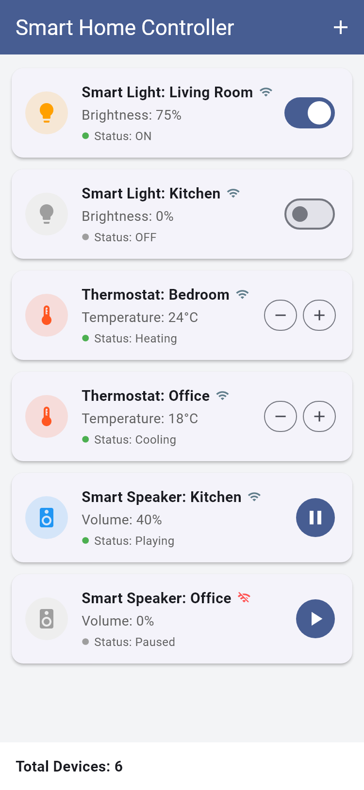
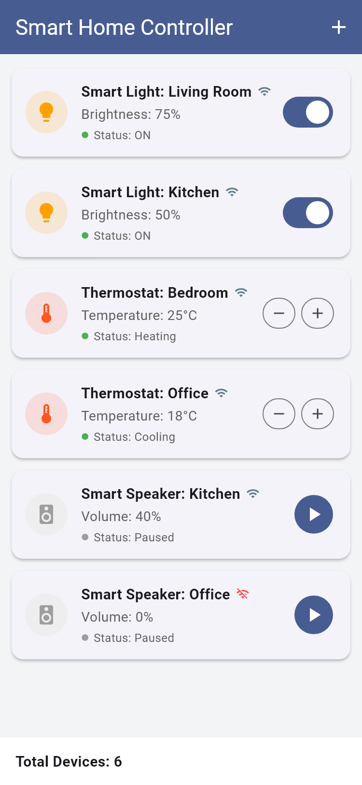
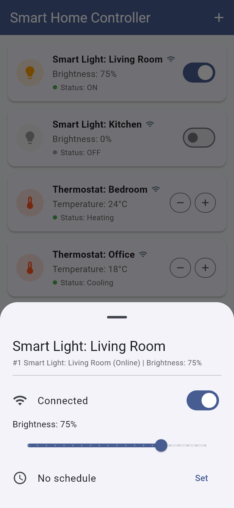
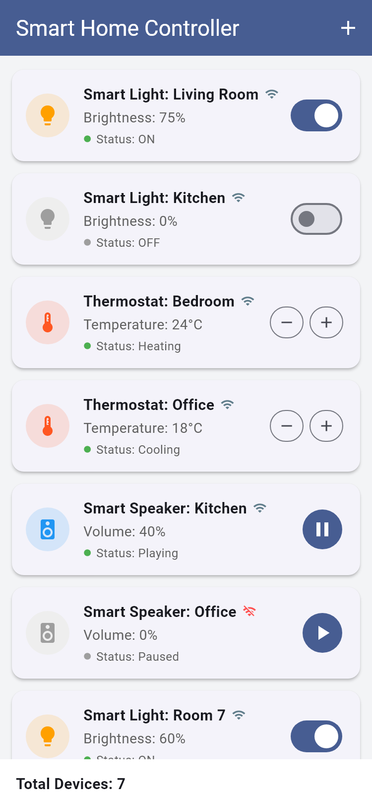

# Smart Home Controller

BIM493 – Mobile Programming I · Assignment #2 (2026–2027)

**GitHub repository:** https://github.com/EminTuran0/smart-home-controller

A Flutter mobile app for viewing and controlling smart home devices: smart lights,
thermostats and smart speakers. Every device is modelled as a Dart class using the
object-oriented features required by the assignment (class, objects, constructors,
inheritance, abstraction, interface, mixin, and the `static`, `super` and `this` keywords).

## Group members

| Full name | Student ID | Contribution |
|-----------|------------|--------------|
| Muhammed Emin Turan | 10112205552 | Device model classes (`SmartDevice`, `SmartLight`, `Thermostat`, `SmartSpeaker`), `Connectable` interface, `Schedulable` mixin, static device counter, unit tests |
| Kayra Özgül | 19043106600 | Home screen and widgets (`DeviceCard`, `DeviceDetailsSheet`), device controls, add-device menu, README and screenshots |

## Flutter version

Built with Flutter **3.47.6 (stable channel)**. Output of `flutter --version`:

```
Flutter 3.47.6 • channel stable • https://github.com/flutter/flutter.git
Framework • revision 5fc346839b • 2026-09-30 15:02:49 -0700
Engine • hash b8c8d3d8d5d0095127057f8a29ca8cc53da2167c (revision 692136cb65)
Tools • Dart 3.13.5 • DevTools 2.60.0
```

## Setup and run

```bash
git clone https://github.com/EminTuran0/smart-home-controller.git
cd smart-home-controller
flutter pub get
flutter run
```

Run the tests:

```bash
flutter test
```

Build an Android APK (optional):

```bash
flutter build apk --release
```

## Requirements and where they are implemented

| Concept | Requirement | Implementation |
|---------|-------------|----------------|
| Class | Base class `SmartDevice` and subclasses `SmartLight`, `Thermostat`, `SmartSpeaker` | `lib/models/` |
| Objects | Multiple instances, at least one of each subclass | `_HomeScreenState.initState` in `lib/main.dart` creates 6 devices (2 of each type); the **+** button adds more |
| Constructor | Default and named constructors | Default: `SmartLight(...)`, `Thermostat(...)`, `SmartSpeaker(...)`, `SmartDevice(...)`. Named: `SmartLight.off`, `Thermostat.eco`, `SmartSpeaker.muted`, `SmartDevice.offline` |
| Inheritance | Subclasses extend `SmartDevice` | `class SmartLight extends SmartDevice with Schedulable`, `class Thermostat extends SmartDevice with Schedulable`, `class SmartSpeaker extends SmartDevice` |
| Abstraction | `SmartDevice` is abstract with abstract methods | `abstract class SmartDevice` with `getStatus()`, `performAction()`, `getPropertyLabel()`, `typeName`, `isActive` |
| Interface | `Connectable` with at least one method, implemented by the devices | `abstract interface class Connectable` (`connect()`, `disconnect()`, `isConnected`), implemented by `SmartDevice` and so by every device |
| Mixin | `Schedulable`, used in a suitable device class | `mixin Schedulable on SmartDevice` (`setSchedule()`, `clearSchedule()`, `scheduleInfo`), used by `SmartLight` and `Thermostat` |
| Keywords | `static`, `super`, `this` | `static`: `SmartDevice.totalDevices`, `SmartDevice.resetCounter()`, `Thermostat.minTemperature/maxTemperature`. `super`: `super.name` constructor parameters, `super.offline()` in `SmartSpeaker.muted`, `super.getInfo()` in every overridden `getInfo()`. `this`: `this.name`, `this.isOn` initializing formals, `this(...)` redirect in `SmartDevice.offline`, `this.volume = volume` in `setVolume()` |

## Features (UI)

- **Device list:** one card per device (Smart Light, Thermostat, Smart Speaker).
- **Device information:** each card shows the device name, its property
  (brightness, temperature or volume), its status with a coloured dot, and a
  Wi-Fi icon for the connection state.
- **Interaction:**
  - Smart Light – switch to turn it on/off.
  - Thermostat – **−** / **+** buttons to change the temperature (10–30 °C);
    status changes between *Heating*, *Cooling* and *Idle*.
  - Smart Speaker – play/pause button.
- **Details panel:** tap a card to connect/disconnect the device (`Connectable`),
  set or clear a schedule (`Schedulable`), change brightness or volume with a
  slider, or turn a thermostat on/off.
- **Add device:** the **+** button in the app bar creates a new light, thermostat or speaker.
- **Bottom text:** `Total Devices: N`, read from the static variable
  `SmartDevice.totalDevices`, which is increased in the `SmartDevice` constructor.

## Screenshots

| Home | Controls used | Details panel | Device added |
|------|---------------|---------------|--------------|
|  |  |  |  |

*Controls used:* Kitchen light turned on, Bedroom thermostat raised to 25 °C,
Kitchen speaker paused. *Device added:* a new Smart Light was added and the
total changed from 6 to 7.

The screenshots are rendered by `tool/screenshots_test.dart`
(`flutter test tool/screenshots_test.dart --update-goldens`).

## Project structure

```
lib/
  main.dart                          App, home screen, device list, total devices
  models/
    connectable.dart                 Connectable interface
    schedulable.dart                 Schedulable mixin
    smart_device.dart                Abstract base class + static counter
    smart_light.dart                 SmartLight
    thermostat.dart                  Thermostat
    smart_speaker.dart               SmartSpeaker
  widgets/
    device_card.dart                 Card with info and control for each device
    device_details_sheet.dart        Details panel (connection, schedule, sliders)
test/widget_test.dart                Unit and widget tests
tool/screenshots_test.dart           Generates the screenshots
screenshots/                         Screenshots for this README
```

## Tests

`flutter test` runs unit tests for the models (static counter, device actions,
statuses, schedule, connection) and a widget test that checks the device cards,
the thermostat **+** button, adding a device, and the `Total Devices` text.

## Known limitations

- Devices are simulated in memory; there is no real smart home hardware or network.
- Device states reset when the app is restarted.
- The UI text is English only.
